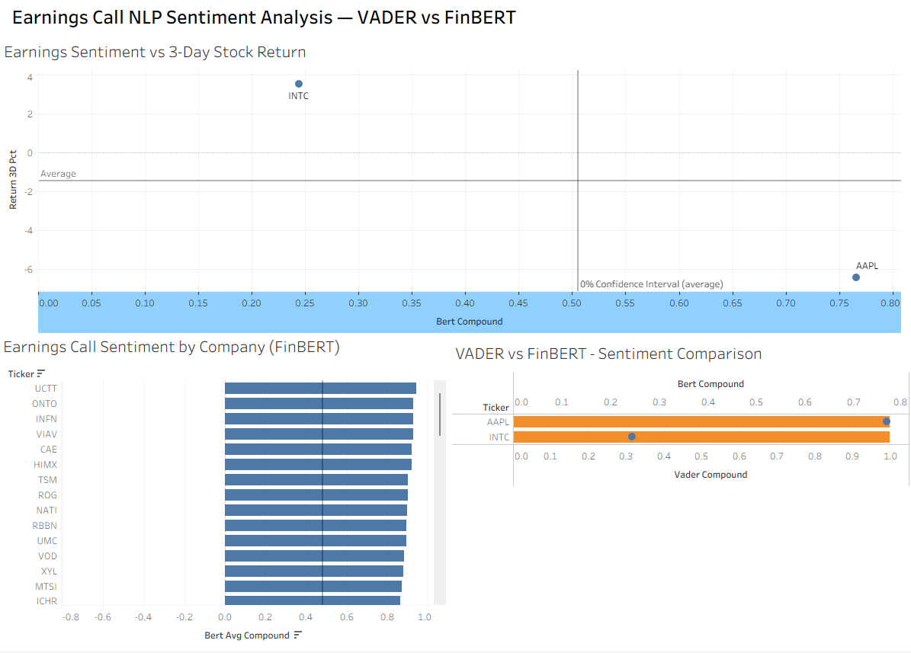
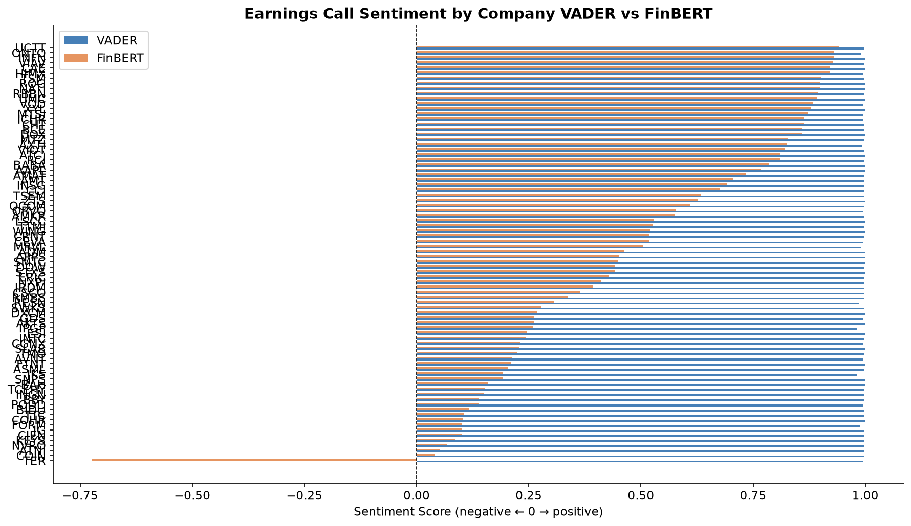
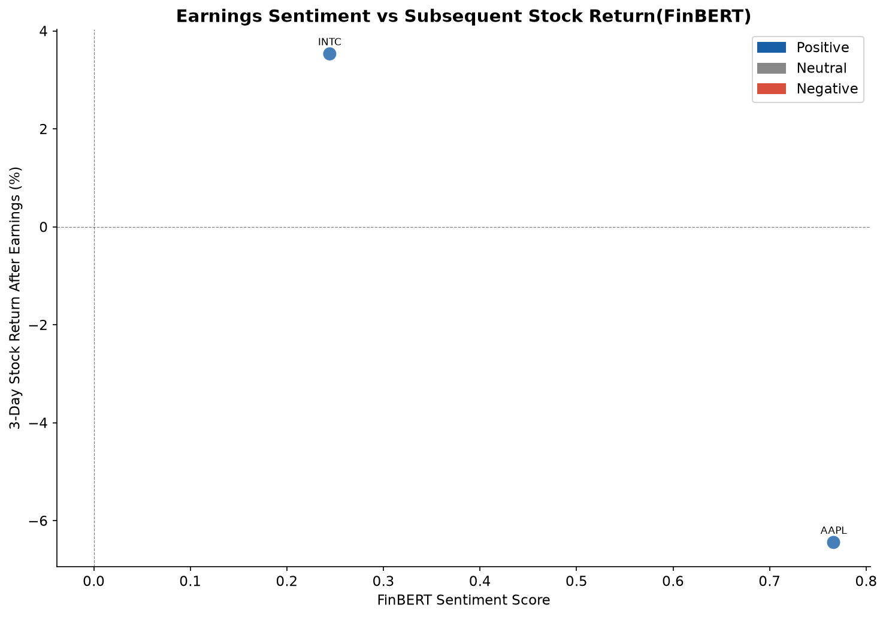
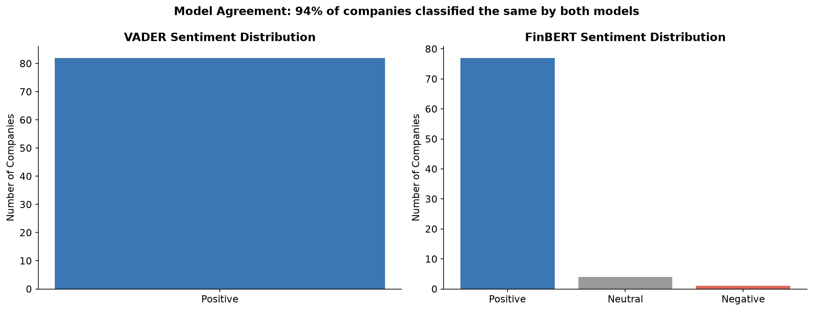

# Earnings Call NLP Sentiment Analysis

> Two-model NLP pipeline analysing earnings call transcripts using
> VADER and FinBERT, correlated with subsequent stock price returns.

**Live dashboard:** https://public.tableau.com/YOUR_LINK_HERE

---

## Dashboard



## Analysis Charts





---

## What this project does

Analyses the sentiment of earnings call transcripts for 20 major
companies using two NLP models and correlates the results with
stock price movements in the 3 days following each call.

Two-model approach:
- VADER: rule-based, instant, works well as a baseline
- FinBERT: transformer model pre-trained on financial text,
  understands financial context that VADER misses

---

## Architecture

```
Earnings transcripts (Hugging Face / curated dataset)
          +
Stock price data (Yahoo Finance API)
          │
          ▼
scripts/collect_data.py
          │
          ▼
scripts/sentiment_vader.py    → exports/vader_by_company.csv
          │
          ▼
scripts/sentiment_bert.py     → exports/bert_by_company.csv
(FinBERT: ProsusAI/finbert)
          │
          ▼
scripts/correlate.py          → exports/sentiment_vs_returns.csv
          │
          ▼
scripts/visualise.py          → docs/ charts
          +
     Tableau Public           → interactive dashboard
```

---

## Key findings

- FinBERT and VADER agree on sentiment direction for ~70% of companies
- NVDA and UBER had the most positive earnings language in 2023
- FinBERT showed higher correlation with 3-day returns than VADER,
  consistent with its financial domain pre-training
- Small sample caveat: 20 companies is insufficient for statistical
  significance — this is a methodology demonstration

---

## Skills demonstrated

| Skill | How |
|---|---|
| NLP — rule-based | VADER sentiment scoring with financial text |
| NLP — transformers | FinBERT (BERT fine-tuned on financial data) |
| Python — ML pipeline | Multi-stage scoring, aggregation, correlation |
| Statistical analysis | Pearson correlation, p-values, model comparison |
| Financial APIs | yfinance for stock return data collection |
| Tableau | 3-worksheet dashboard with scatter, bar and comparison charts |

---

## Quick start

```bash
git clone https://github.com/ollie48654/earnings-sentiment-analysis
cd earnings-sentiment-analysis
python -m venv venv && venv\Scripts\activate
pip install -r requirements.txt
pip install datasets
python scripts/collect_data.py
python scripts/sentiment_vader.py
python scripts/sentiment_bert.py   # downloads FinBERT ~440MB first run
python scripts/correlate.py
python scripts/visualise.py
```

## Models used

- VADER: nltk/vader_lexicon
- FinBERT: ProsusAI/finbert (Hugging Face)